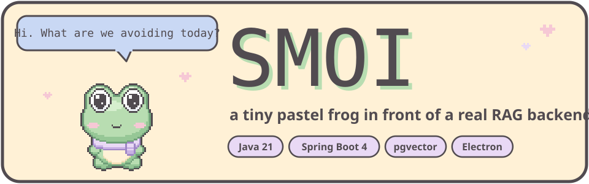
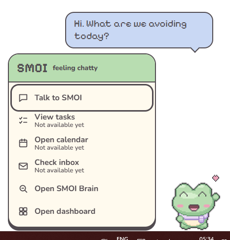
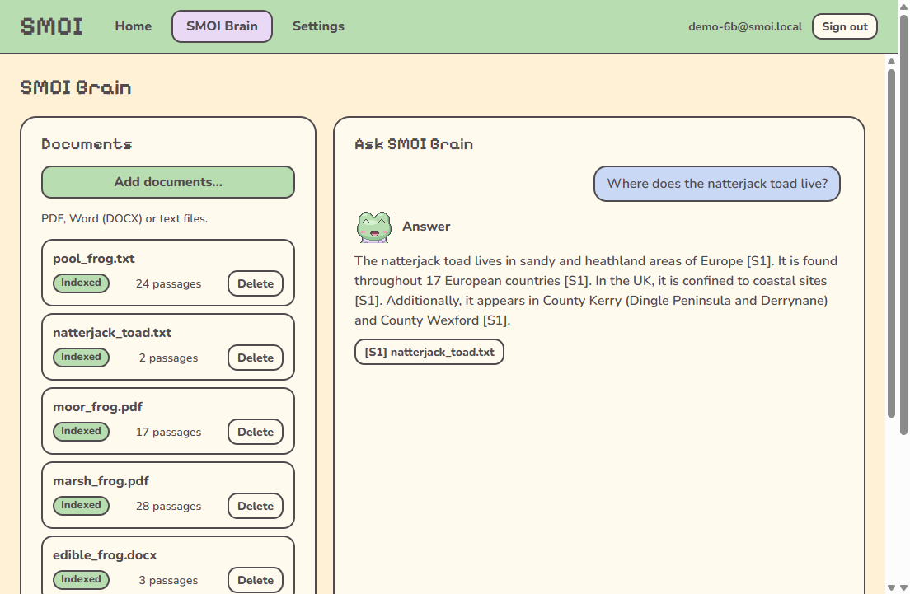
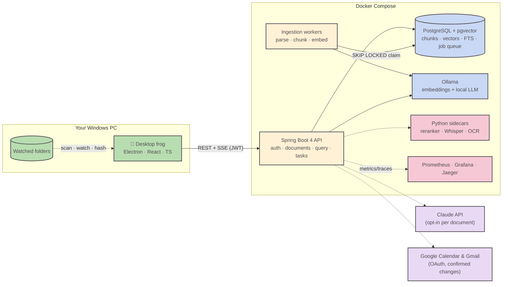
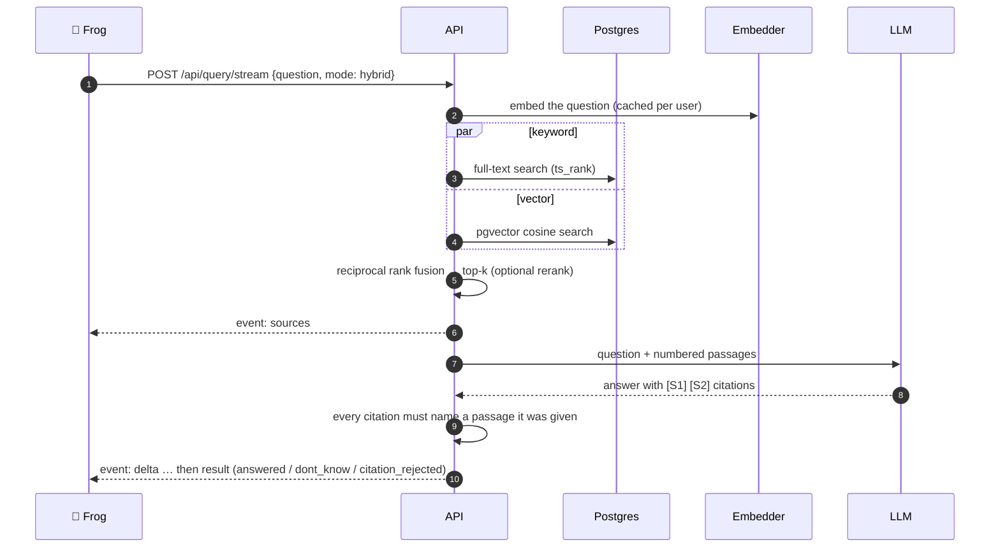

<p align="center">
  
</p>

<p align="center">
  
  
  
  
  
</p>

<p align="center">
  
  
  
  
  
  
  
</p>

<p align="center"><i>Affectionate, slightly chaotic, occasionally sarcastic, a little dramatic.</i></p>

---

**SMOI** lives on your Windows desktop as a pixel-art frog. Behind it is a retrieval-augmented
generation (RAG) backend written from scratch in Java. Feed it your documents or whole folders
(**SMOI Brain**), ask questions, and get answers that cite the exact page or section they came
from. If your documents don't say, SMOI says it doesn't know.

Around the brain, SMOI also handles tasks and reminders (typed or spoken), shows your calendar,
sorts and summarises unread mail, and celebrates when a Claude Code run finishes. Changes to
Google always need your confirmation, and SMOI only ever *drafts* email. It never sends or deletes.

<table>
  <tr>
    <td width="38%"></td>
    <td width="62%"></td>
  </tr>
  <tr>
    <td align="center"><sub>Click the frog: speech bubble and menu panel</sub></td>
    <td align="center"><sub>SMOI Brain: a cited answer from your own files</sub></td>
  </tr>
</table>

## 🐾 Pick your companion

SMOI the frog is the default, but it isn't the only option. Choose who sits on your desktop from
the **Companions** screen in the dashboard. Each one has its own sprites and voice. Your tasks, settings and
documents stay the same whoever you pick.

<table>
  <tr>
    <td align="center" width="20%"></td>
    <td align="center" width="20%"></td>
    <td align="center" width="20%"></td>
    <td align="center" width="20%"></td>
    <td align="center" width="20%"></td>
  </tr>
  <tr>
    <td align="center"><b>SMOI</b><br><sub>frog · default</sub></td>
    <td align="center"><b>NUMI</b><br><sub>axolotl</sub></td>
    <td align="center"><b>NOX</b><br><sub>bat</sub></td>
    <td align="center"><b>YUZU</b><br><sub>capybara</sub></td>
    <td align="center"><b>WISP</b><br><sub>moth</sub></td>
  </tr>
  <tr>
    <td align="center"><sub><i>Affectionate, slightly chaotic, a little dramatic.</i></sub></td>
    <td align="center"><sub><i>Dreamy, gentle, forgetful.</i></sub></td>
    <td align="center"><sub><i>Dry, sarcastic night owl.</i></sub></td>
    <td align="center"><sub><i>Deadpan, completely unbothered.</i></sub></td>
    <td align="center"><sub><i>Anxious, excitable, drawn to bright screens.</i></sub></td>
  </tr>
  <tr>
    <td align="center"><sub>“LOOK AT YOU GO!!”</sub></td>
    <td align="center"><sub>“Oh! Hi. Was I... doing something?”</sub></td>
    <td align="center"><sub>“It's 2am. Bold of you.”</sub></td>
    <td align="center"><sub>“Deadline missed. Anyway.”</sub></td>
    <td align="center"><sub>“Ooh, a new tab! It's so bright!”</sub></td>
  </tr>
</table>

## 🐸 What's inside

| | |
| --- | --- |
| **Hand-written retrieval** | Keyword search (Postgres full-text), vector search (pgvector) and hybrid search merged with reciprocal rank fusion. No LangChain, no framework retrievers: the SQL, scoring and fusion are in this repo. |
| **Checked citations** | The model may only cite passages it was given. If it cites anything else, the answer is withheld (`citation_rejected`). |
| **Postgres job queue** | Ingestion jobs are claimed with `FOR UPDATE SKIP LOCKED`, retried with backoff and dead-lettered with a reason. A crashed worker's job is picked up again when its lease expires. |
| **Structure-aware chunking** | Apache Tika parses PDF, DOCX and TXT. Chunks follow headings and paragraphs and keep page numbers and the heading path. |
| **Folder sync** | The desktop app watches your folders. It catches edits made while SMOI was closed, pairs renames and moves by content hash, and flags scanned PDFs for an optional OCR sidecar. |
| **Swappable providers** | The LLM, embedder and reranker sit behind interfaces chosen by configuration: local Ollama by default, Claude when you opt in per document. |
| **Treats content as untrusted** | Documents, mail and calendar entries are data, never instructions. The LLM can only *propose* actions as structured output, and the backend checks each one against an allowlist. |
| **Observable and resilient** | Prometheus metrics per pipeline stage, Jaeger traces, JSON logs with request ids, circuit breakers, per-user rate limits, and fallbacks when the LLM or embedder is down. |
| **Multi-tenant by default** | Every user-owned table has `user_id` and soft deletes, and every query filters on both. |

## 🔧 Architecture



### How a question becomes an answer



## 🧠 Decisions worth asking about

Each one is written up as an ADR: context, decision, rejected alternatives and consequences.

| Decision | Why | ADR |
| --- | --- | --- |
| Postgres as the job queue, not Kafka/RabbitMQ | One less moving part. The upload and its job row commit in one transaction. | [0005](docs/adr/0005-postgres-job-queue.md) |
| Store uploads in Postgres | One transaction covers the file, the document row and its ingestion job | [0007](docs/adr/0007-store-uploaded-files-in-postgres.md) |
| RRF instead of weighted score fusion | Ranks avoid normalising `ts_rank` against cosine similarity | [0008](docs/adr/0008-retrieval-and-cited-answers.md) |
| Providers behind interfaces | Local by default, hosted by explicit opt-in per document | [0009](docs/adr/0009-llm-providers.md) |
| Testcontainers, never H2 | pgvector and full-text search only behave like production on real Postgres | [0004](docs/adr/0004-testcontainers-for-integration-tests.md) |
| Desktop watches folders, backend records | Docker can't see your folders, and documents never leave the machine | [0019](docs/adr/0019-folder-sync.md) |

All decisions: [`docs/adr/`](docs/adr) · Requirements: [`docs/srs.md`](docs/srs.md) ·
Requirement → test map: [`docs/traceability.md`](docs/traceability.md)

## 🚀 Run it

Requires Docker Desktop.

```sh
cp .env.example .env          # set POSTGRES_PASSWORD and JWT_SECRET (openssl rand -base64 32)
docker compose up --build     # first run also pulls nomic-embed-text (~274 MB)
```

Then start the frog:

```sh
cd desktop
npm install
npm start
```

| Service | URL |
| --- | --- |
| API health | http://localhost:8080/livez · `/readyz` |
| OpenAPI spec | http://localhost:8080/v3/api-docs |
| Grafana (SMOI folder) | http://localhost:3000 |
| Jaeger traces | http://localhost:16686 |
| Prometheus | http://localhost:9090 |

The default LLM runs locally through Ollama (`qwen3.5:2b-q4_K_M`). To use Claude, set
`LLM_PROVIDER=anthropic` and `ANTHROPIC_API_KEY` in `.env`. Only documents you've allowed are sent.
The reranker runs with `docker compose --profile rerank up` and `RERANK_ENABLED=true`.

## 🧪 Test it

```sh
cd backend && ./mvnw verify   # unit + integration tests against real Postgres/pgvector (needs Docker)
cd desktop && npm test        # vitest unit and component tests
```

Backend tests use a deterministic hashing embedder, so you don't need to download a model. CI
(`.github/workflows/backend.yml`) runs `./mvnw verify` on every push and pull request. Load and
failure tests (`python loadtest/run.py query|search|upload|worker-kill|llm-down|scale`) and the
evaluation harness (`eval/`) write their measured results to [`docs/performance.md`](docs/performance.md)
and `eval/results/`.

<details>
<summary><b>📚 API reference</b></summary>

All endpoints except register and login need `Authorization: Bearer <accessToken>`.

**Auth**

| Request | What it does |
| --- | --- |
| `POST /api/auth/register` `{"email", "password"}` | Create an account (password 12 to 72 characters) |
| `POST /api/auth/login` | Returns `{"accessToken", "tokenType": "Bearer", "expiresAt"}` |
| `GET /api/me` | Current user |

**SMOI Brain documents**

| Request | What it does |
| --- | --- |
| `POST /api/documents` (multipart `file`) | Upload a PDF, DOCX or TXT (up to 25 MB). `202` with `{"id", "status": "queued"}`, or `200` with the existing document if it's a duplicate. |
| `GET /api/documents` | Your documents, newest first: `queued`, `processing`, `indexed` or `failed` (with `error`) |
| `GET /api/documents/{id}` | One document's status |
| `GET /api/documents/{id}/chunks` | Its chunks, with `pageStart`/`pageEnd` (PDF) and `section` (heading path) |
| `PUT /api/documents/{id}/file` | Replace the file and re-index. Old chunks stay searchable until the new ones are stored. |
| `DELETE /api/documents/{id}` | Delete the document, its file, chunks and vectors |
| `PATCH /api/documents/{id}` `{"hostedLlmAllowed": true}` | Allow this document to be sent to a hosted LLM (off by default) |

**Asking questions**

| Request | What it does |
| --- | --- |
| `POST /api/query` `{"question", "mode": "hybrid", "topK": 6}` | Cited answer. `outcome`: `answered`, `dont_know`, `refused`, `citation_rejected` (502) or `llm_unavailable` (passages only). Includes provider, model and per-stage timings. |
| `POST /api/query/stream` | Same, as server-sent events: `sources`, `delta`, `result` |
| `POST /api/search` `{"query", "mode"}` | Retrieval only. Modes: `keyword`, `vector`, `hybrid`, `hybrid_rerank` |
| `POST /api/documents/{id}/summary` | Cited summary |
| `POST /api/documents/compare` `{"first", "second"}` | Cited comparison |
| `GET /api/settings/providers` | Active LLM, embedder and reranker, and whether each is hosted |

```sh
curl -H "Authorization: Bearer $TOKEN" -F file=@notes.pdf http://localhost:8080/api/documents
```

</details>

## 🗂️ Repository

```
backend/        Spring Boot API, ingestion workers, Flyway migrations
desktop/        Electron frog app (see desktop/README.md)
sidecars/       Python FastAPI helpers: reranker, Whisper (voice), OCR
eval/           Evaluation harness, demo corpus and question set
loadtest/       k6 load tests and failure tests
observability/  Prometheus config and Grafana dashboards
docs/           srs.md, adr/, design/ (SMOI's character design is the source of truth for its look)
```

## 🗺️ Roadmap

- [x] **0** Setup
- [x] **1** Ingestion: parse, chunk, embed, Postgres job queue
- [x] **2** Retrieval: keyword, vector, hybrid, rerank, cited answers
- [x] **3** Evaluation harness
- [x] **4** Observability and resilience
- [ ] **5** Security hardening
- [x] **6** Desktop frog: sprites, bubbles, menu panel, dashboard
- [x] **7** Tasks, reminders and voice
- [x] **8** Google Calendar and Gmail *(built; still to be tested on a real Google account)*
- [ ] **9** Packaging
- [x] **10** Claude Code notifications
- [x] SMOI Brain upgrade: folder sync and needs-OCR

<p align="center">
  <br>
  <sub>SMOI never looks at your other windows. It just naps when you're away.</sub>
</p>
