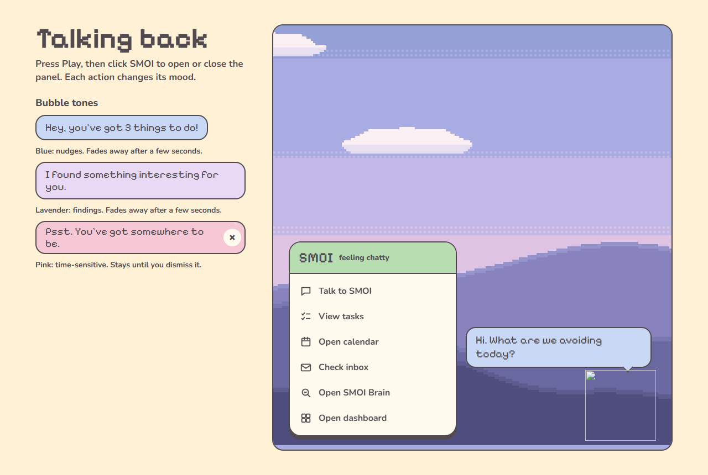
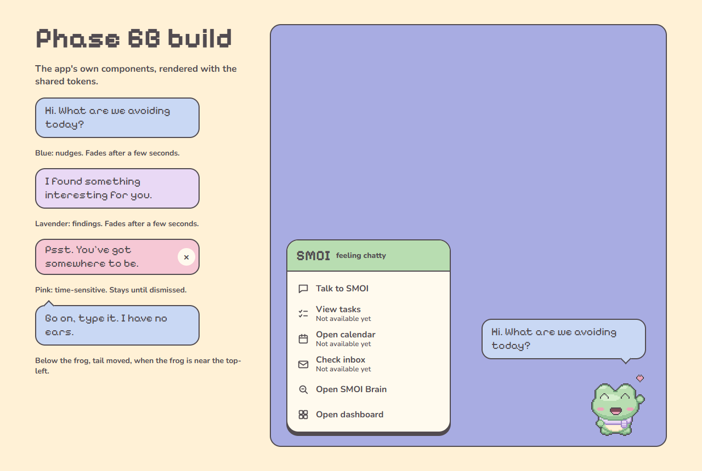
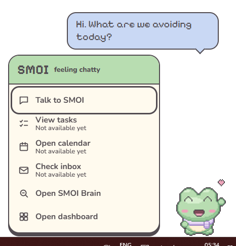
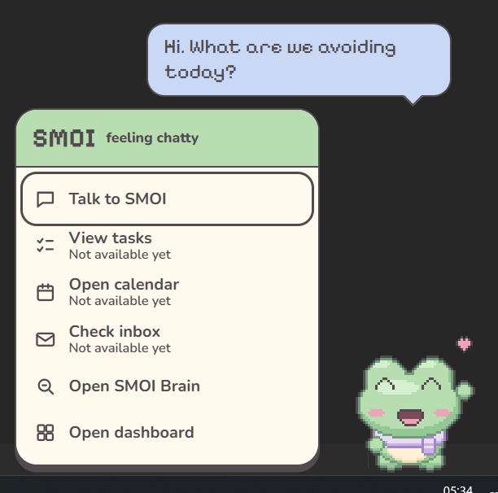

# Phase 6B: build compared with the design

The design board is "SMOI speech bubble and panel" in `docs/design/smoi-character-design.html`.
Screenshots are in `docs/design/phase6b/`.

| File | What it is | Made by |
| --- | --- | --- |
| `design-board.png` | The board, rendered exactly as stored (its frog image is broken in the saved file) | `desktop/scripts/capture-ui.mjs` |
| `build-gallery.png` | The app's own bubble and panel components, laid out like the board | `desktop/scripts/capture-ui.mjs` |
| `desktop-100.png` | The real Windows desktop: frog, bubble and open panel at 100% | `desktop/scripts/desktop-check.ts` |
| `desktop-125-second-monitor.png` | The same, on a second monitor at its real 125% scaling | `desktop/scripts/desktop-check.ts` |
| `dashboard-answer.png`, `dashboard-source.png` | A question asked from the frog, answered with citations, and the cited passage opened | `desktop/scripts/desktop-check.ts` |

## Side by side

| Design board | Build |
| --- | --- |
|  |  |

On the real desktop:

| 100% | Second monitor, 125% |
| --- | --- |
|  |  |

## Differences from the board

Approved by the owner for Phase 6B:

1. **Unavailable rows.** View tasks, Open calendar and Check inbox show a second line, "Not
   available yet" (Nunito 13px). They keep the 46px row height, and they don't turn lavender on
   hover, since there's nothing to choose.
2. **Talk to SMOI** says "Go on, type it. I have no ears." with the mood "ready to chat", and SMOI
   stays idle. The board's listening state shows a microphone chip, and there's no microphone yet.
3. **Open SMOI Brain** shows no line. "I found something interesting for you." appears only when
   an answer with valid citations arrives.

My interpretation, for review:

4. **Tail position.** On the board the tail is fixed 34px from the bubble's right edge. In the app
   it points at the frog's centre: about 40px from the right edge by default, moving along the
   bubble when the bubble is pushed sideways near a screen edge.
5. **Bubble below the frog.** When the frog is at the top of the screen, the bubble goes below it
   with the tail on top (the last sample in the gallery). The board has no such case.
6. **Fading out.** The board says blue and lavender bubbles "fade away after a few seconds" but
   defines no animation. The app uses a 200ms opacity fade. Bubbles show for 4 seconds, plus 70ms
   per character beyond about 35, so long lines can be read.
7. **Reduced motion.** With reduced motion on, `smoi-pop`, `smoi-rise` and the fade are skipped.
8. **Placement on the desktop.** The panel goes 12px to the left of the frog, flipping to the
   right when there's no room. It sits 6px above the frog's feet, so its hard shadow doesn't spill
   onto the taskbar. On the board the panel is at the far side of the stage.
9. **Focus.** When the panel opens, the first row has keyboard focus and shows the design's 3px
   charcoal outline. The board starts with nothing focused.
10. **Tone samples wrap.** The board's sample bubbles (left column) have no maximum width. The
    app's bubble always uses the live bubble's 300px maximum, so two samples wrap onto two lines.
11. **The x button** uses Nunito 800 at 18px, the board's declared weight and size. On the board
    the button falls back to the browser's default button font, so the glyph is slightly different.
12. **The frog in the gallery** is the happy sprite's first frame, because the board's own frog
    image is broken.

## The dashboard, login and SMOI Brain screens (not in the design)

These screens are my interpretation, built only from the design's tokens:

- the cream page and `#FFFAEE` cards with 2px charcoal borders, as on the concept sheet;
- Pixelify Sans for headings;
- Nunito for everything people read at length, including answers and passages;
- the expression faces as small status icons beside text that says the same thing.

Please review them. Screenshots: `phase6b/dashboard-answer.png` and `phase6b/dashboard-source.png`.

## Contrast (WCAG 2.2 AA)

`desktop/test/contrast.test.ts` reads `tokens.css` and checks every pair the UI uses. All text is
Soft Charcoal `#514B50`.

| Text on | Ratio | AA (4.5:1) |
| --- | --- | --- |
| Frog Green `#B8DDB1` (panel header, primary buttons, "Indexed" tag) | 5.67:1 | Pass |
| Blush Pink `#F6C8D5` (pink bubble, error banners, "Failed" tag) | 5.72:1 | Pass |
| Powder Blue `#C9D8F4` (blue bubble, info banners, your questions) | 5.91:1 | Pass |
| Lavender `#E9D9F5` (lavender bubble, hover, current tab, cited passage) | 6.35:1 | Pass |
| Cream `#FFF1D6` (dashboard page) | 7.61:1 | Pass |
| Panel `#FFFAEE` (panel, cards, inputs) | 8.16:1 | Pass |

Focus outlines and borders (charcoal, 3:1 needed) pass on every background above.

Not covered by the token check:

- **Chromium's disabled checkbox** ("Walk along the taskbar" while reduced motion is on) is drawn
  in Chromium's grey. WCAG exempts disabled controls. The hint below it says why it's off, in
  charcoal.
- **The chat box placeholder was removed.** Chromium's default placeholder grey is about 2.3:1.
  The hint "Enter sends. Shift+Enter starts a new line." is now ordinary charcoal text under the
  box.
- **Native Windows UI** (the file picker, the delete confirmation and the tray menu) uses the
  system theme.
- **The expression faces and the frog** are decorative images. The text beside them carries the
  meaning.

## Desktop check results

Produced by `desktop/scripts/desktop-check.ts` on 2026-11-03, against the built app (`npm run build`) with the Docker Compose backend, the local Ollama models and the frog documents from `eval/corpus/docs/frogs/`. The check found three real bugs before this run, all fixed (ADR 0013, commit "Fix focus return, a dashboard crash and edge placement found on the real desktop").

- **Real scaling:** this machine's own displays. Monitor 1 is a 1920x1080 display at 100%; monitor 2 runs at 125%.
- **Forced scaling:** both monitors at 100%, 125% and 150%, set with Chromium's `--force-device-scale-factor`.
- **The other app** is a plain test window, which receives focus and clicks. It sits on monitor 1, so the click-through checks run there only (n/a on monitor 2).
- **Input:** real mouse moves, clicks and key presses (Windows `SendInput`).
- **Pixel checks:** screen captures with reduced motion on, so the frog holds a still pose.

Result: **0 failures.**

| Check | real 100%, monitor 1 | real 125%, monitor 2 | forced 100%, monitor 1 | forced 100%, monitor 2 | forced 125%, monitor 1 | forced 125%, monitor 2 | forced 150%, monitor 1 | forced 150%, monitor 2 |
| --- | --- | --- | --- | --- | --- | --- | --- | --- |
| Frog is crisp: every art pixel an even square of device pixels (2x2 at 100%, 3x3 at 125% and 150%) | pass | pass | pass | pass | pass | pass | pass | pass |
| Clicking the frog opens the panel | pass | pass | pass | pass | pass | pass | pass | pass |
| The open panel has keyboard focus | pass | pass | pass | pass | pass | pass | pass | pass |
| The hello bubble is showing | pass | pass | pass | pass | pass | pass | pass | pass |
| Panel and bubble are fully on the frog's display | pass | pass | pass | pass | pass | pass | pass | pass |
| Frog doesn't shift by a pixel while the bubble and panel are open | pass | pass | pass | pass | pass | pass | pass | pass |
| Arrow keys move through the rows | pass | pass | pass | pass | pass | pass | pass | pass |
| Esc closes the panel | pass | pass | pass | pass | pass | pass | pass | pass |
| Closing the panel hands focus back to the other app | pass | pass | pass | pass | pass | pass | pass | pass |
| A bubble appears without taking focus | pass | pass | pass | pass | pass | pass | pass | pass |
| With the panel open, a click on the empty edge of its window reaches the app underneath | pass | n/a | pass | n/a | pass | n/a | pass | n/a |
| With the panel open, a click on a transparent pixel of the frog window reaches the app underneath | pass | n/a | pass | n/a | pass | n/a | pass | n/a |

Run once, at real scaling on monitor 1:

| Check | Result |
| --- | --- |
| Talk to SMOI opens the chat with the question box focused (2 interactions) | pass |
| The question is answered | pass |
| Clicking a citation opens the cited passage | pass |

The answer took 28 s end to end on this machine (CPU-only local model), as reported by the same run. That is one sample, not a benchmark.

## What you need to check by hand

The desktop check uses real mouse and keyboard input, but some things it can't judge or reach:

1. **Looks.** Compare the screenshots above with the board, and review the dashboard screens,
   which are my interpretation.
2. **Real scaling changes while SMOI runs.** Change Windows display scaling (Settings > Display >
   Scale) to 125%, 150% and 175% with the frog and panel showing. The check forces those scales in
   Chromium and uses each monitor's real scaling, but doesn't change the Windows setting live.
3. **Dragging between monitors by hand,** with the panel open and with a pink bubble showing.
   Both should follow the frog and stay on its monitor. The check moves the frog by code.
4. **Screen readers (Narrator or NVDA):**
   - does a bubble get announced with the panel closed? This is unverified (ADR 0013);
   - with the panel open, the line should be read, and rows should read "View tasks, Not
     available yet";
   - the dashboard should read well throughout.
5. **The tray menu with the keyboard.** Use Win+B, then the arrow keys to reach SMOI, and choose
   "Open SMOI menu": the panel should open with focus. Also try "Dismiss SMOI's message" with a
   pink bubble showing.
6. **Upload through the file picker.**
   - Upload a PDF, a DOCX and a TXT, and try an unsupported file: the error should name the file
     and say what is accepted.
   - Delete a document: the confirmation dialog should appear, and Cancel should keep it.
7. **Backend down.** Run `docker compose stop backend`:
   - after about 30 seconds the frog shows the error state, and the dashboard says it can't reach
     the backend at its address;
   - start it again and both recover.
8. **LLM fallback.** Stop Ollama and ask a question. Expect the banner "The language model is
   unavailable…" with the passages listed, and a brief error state on the frog. Ollama also
   serves embeddings, so retrieval falls back to keyword search at the same time.
9. **Indexing in progress.** Upload a large PDF:
   - the frog shows working and the dashboard shows the indexing banner;
   - both end when it's indexed, and document status stops being polled.
10. **Session expiry.** After an hour, or after signing out, the next request returns to sign-in
    with "Your session has expired. Please sign in again."
11. **Windows "Animation effects" off** (Settings > Accessibility > Visual effects): the frog holds
    still poses, and bubbles and the panel appear without moving.
12. **Keyboard through the whole dashboard.** Tab order, visible focus on every control, Esc
    closing the source viewer, and focus returning to the citation you opened it from.
